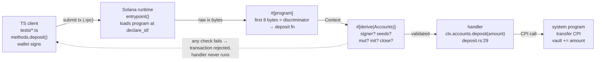
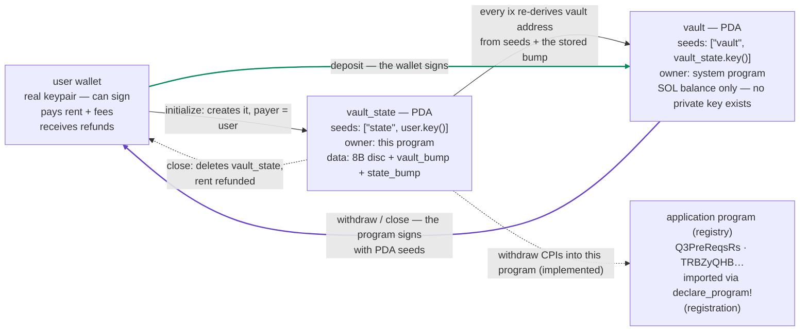
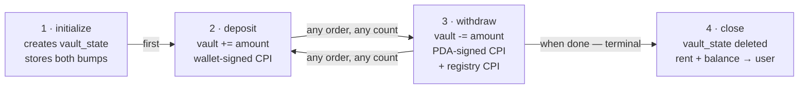

# Pre-req Vault Map

Three diagrams of how the vault program fits together. Companion page to
[Understanding the Pre-req Vault](understanding-the-vault.md) — that document has the prose,
on-chain evidence and byte layouts; this one has the pictures.

Program: `Cdew9Y89YgSVS184JFdo38ouTQbaji8rkzUAUUjdKZGs` (devnet) · Anchor 1.2.1

## 1. One transaction, end to end — `deposit` as the example

Everything from `runtime` onward runs inside the deployed program; nothing before `handler` is
hand-written code. Anchor generated the entrypoint, the discriminator routing and the account
checks from the macros in `lib.rs` and `deposit.rs`. The dashed path is why the account struct
doubles as the program's access-control layer: validation failure stops the transaction before
any lamports can move.

## 2. The accounts, and who can sign for each

Green edge: lamports move with a wallet signature. Violet edge: lamports move with a PDA-seed
"signature" (`CpiContext::new_with_signer`, `withdraw.rs:33-36`, `close.rs:37-45`). The security
model in one picture: the vault address is derived from `["vault", vault_state.key()]`, so no
keypair anywhere can sign for it — but this program can produce a valid signature at runtime by
supplying those seeds plus the stored bump. Anyone can deposit; only the program's own logic can
release. The registry edge (dashed) is the cross-program call added in
`withdraw.rs:46-57` — verified live: account
[`2D44dQv5…`](https://explorer.solana.com/address/2D44dQv5d6RwuH3pb5fFVqsg6W8fVPEwTJLYzmmZ8vmj?cluster=devnet)
now exists on devnet with `github: "rafael-ariascalles"`.

## 3. Lifecycle of a user's vault

This is exactly the sequence `tests/pre-req-vault.ts` executes against devnet
(`Anchor.toml` has `skip_local_validator = true`), asserting each ledger effect: bumps stored
after step 1, balances shifting after 2 and 3, both account rows gone after 4 — verified on-chain
2026-10-20; see the [transaction table](understanding-the-vault.md#0-the-on-chain-evidence).
